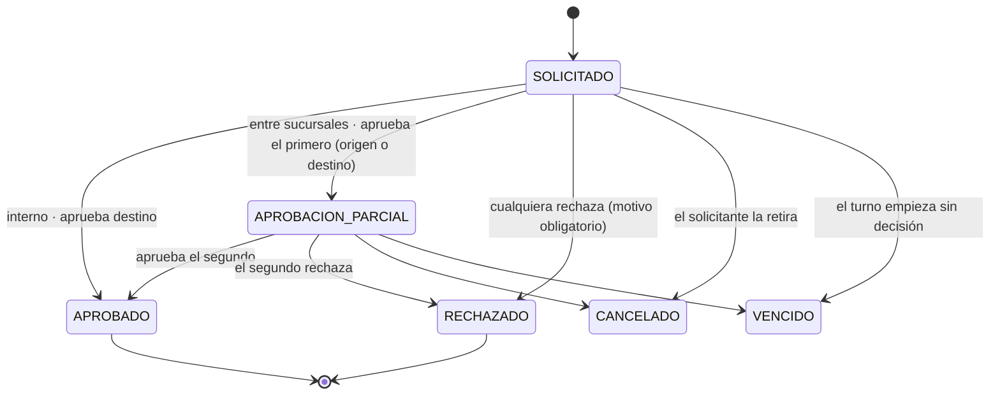

# Cambios en el modelo de datos · v2 (Sprint 1)

El modelo físico de la semana 4 (versión 1) tenía 5 esquemas y 23 tablas. Al programar `ms-organizacion` y `ms-empleados` encontramos ajustes necesarios, que se aplican como migraciones nuevas sin modificar las anteriores. Así, cualquier ambiente se puede reconstruir en orden con Flyway.

| Migración | Esquema | Cambio | Motivo |
|---|---|---|---|
| `org/V3__mejoras_sprint1.sql` | ORG | FK `EQUIPO.EMPRESA_ID` → `EMPRESA` y FK `COORDINADOR_EQUIPO.EMPRESA_ID` → `EMPRESA` | En v1 la empresa del equipo solo se validaba en la API. Ahora la base también la asegura. |
| | ORG | Columna `VERSION` en `EMPRESA`, `SUCURSAL` y `EQUIPO` | Control de concurrencia optimista (`@Version`). Si dos administradores editan lo mismo a la vez, el segundo recibe 409 y no pisa el cambio del primero. |
| | ORG | `CHECK` del formato del RUT (`76123456-0`) y del correo de contacto | El RUT se guarda normalizado (sin puntos). El dígito verificador lo valida la API. |
| | ORG | Índice único por función `UX_COOEQU_VIGENTE` | Asegura que cada equipo tenga **un solo coordinador vigente** (`VIGENTE_HASTA` nulo). |
| | ORG | Índices `IX_SUC_EMPRESA_ESTADO` y `IX_EQU_EMPRESA_SUCURSAL` | Aceleran las listas de sucursales y equipos que usan las pantallas. |
| `emp/V2__mejoras_sprint1.sql` | EMP | Columna `VERSION` en `EMPLEADO` | Concurrencia optimista al editar fichas. |
| | EMP | `CHECK` del formato del RUT y del correo | Rechaza en la base los datos mal formados (casos CP-21 y CP-22). |
| | EMP | `CHECK` que impide desactivar con una fecha anterior al ingreso a la rotación | Coherencia de fechas para el cálculo de la cuota esperada `e = T × c / Σc`. |
| | EMP | Índices `IX_EMP_EMPRESA_ESTADO`, `IX_EMP_BUSQUEDA` (por `UPPER(APELLIDOS)`) e `IX_OUTEVE_PENDIENTES` | Aceleran la búsqueda de empleados (P04) y el publicador del outbox. |
| `tur/V2__doble_aprobacion_reemplazos.sql` | TUR | `REEMPLAZO` registra **dos decisiones**: `DECISION_ORIGEN` (el coordinador de la sucursal del reemplazante autoriza su salida) y `DECISION_DESTINO` (el coordinador de la sucursal del turno acepta su incorporación). Cada una guarda la ficha y la cuenta de quien decidió, la fecha y el comentario. Columna virtual `TIPO` (`INTERNO` o `ENTRE_SUCURSALES`), estados nuevos `APROBACION_PARCIAL` y `VENCIDO`, `VERSION` e índices para la bandeja de cada coordinador. Reemplaza a `RESUELTO_POR` y `RESUELTO_EN`. | Retroalimentación de la semana 4: un reemplazo entre sucursales requiere la autorización de ambos coordinadores y antes se registraba una sola resolución. |
| `org/V4` y `emp/V3` | ORG y EMP | Datos semilla del ambiente QA | Empresa ficticia con 3 sucursales, 5 equipos y 18 fichas para probar y para la revisión docente. Los RUT son inventados, con dígito verificador válido. |

## Decisiones que se mantienen

- **Sin llaves foráneas entre esquemas.** `EMP.EMPLEADO.SUCURSAL_ID` es una referencia lógica: `ms-empleados` le pregunta a `ms-organizacion` si la sucursal y el equipo existen y están activos antes de guardar.
- **Usuarios de ejecución con mínimo privilegio.** Los servicios se conectan como `ORG_APP` y `EMP_APP`, que solo tienen SELECT, INSERT, UPDATE y DELETE sobre su esquema. Las migraciones las aplica el usuario dueño del esquema.
- **Identidad.** La ficha, el rol, la empresa y la sucursal de cada persona se guardan en Oracle. `EMPLEADO.USUARIO_OID` guarda el identificador de su cuenta en Entra, que se crea por invitación automática al registrarla.

## Doble aprobación de reemplazos (retroalimentación de la semana 4)

Ejemplo: Antonia (Maipú) cubre el turno del sábado de Camila en Centro.

| Decisión | Quién | Qué decide | Columnas |
|---|---|---|---|
| Origen | Coordinador de Maipú, la sucursal de Antonia | Autoriza que Antonia salga de Maipú ese día | `DECISION_ORIGEN`, `ORIGEN_COORDINADOR_ID`, `ORIGEN_DECIDIDO_POR`, `ORIGEN_DECIDIDO_EN`, `ORIGEN_COMENTARIO` |
| Destino | Coordinador de Centro, la sucursal del turno | Acepta que Antonia se incorpore al turno | `DECISION_DESTINO`, `DESTINO_COORDINADOR_ID`, `DESTINO_DECIDIDO_POR`, `DESTINO_DECIDIDO_EN`, `DESTINO_COMENTARIO` |

Un reemplazo **interno** (misma sucursal) solo requiere la decisión de destino. La columna virtual `TIPO` se calcula a partir de las sucursales, así que no se puede contradecir.

**Qué pasa en cada caso**

- **Aprobación parcial:** el turno sigue asignado al solicitante. Se publica `ReemplazoAprobacionParcial` para avisar a la otra sucursal y al trabajador.
- **Aprobado:** solo en este estado `ms-turnos` actualiza `ASIGNACION_TURNO` (`EMPLEADO_EFECTIVO_ID` y `ESTADO = 'REEMPLAZADO'`), en la misma transacción. Luego publica `ReemplazoAprobado`, que actualiza los reportes de equidad.
- **Rechazado por cualquiera de los dos:** el estado es final. La decisión pendiente ya no se pide y el turno queda con quien lo pidió. Se publica `ReemplazoRechazado` con el motivo y el trabajador puede pedir otro reemplazo.
- **Vencido:** si el turno comienza sin todas las aprobaciones, un proceso programado cierra la solicitud y el turno queda con el solicitante.

**Reglas que asegura la base (CHECK en la misma fila)**

| Restricción | Regla |
|---|---|
| `CK_REEMPLAZO_3` y `CK_REEMPLAZO_4` | Cada decisión se guarda completa: valor, coordinador (ficha y cuenta) y fecha, o queda vacía. |
| `CK_REEMPLAZO_5` | Un rechazo siempre lleva un comentario. |
| `CK_REEMPLAZO_6` | Un reemplazo interno no tiene decisión de origen. |
| `CK_REEMPLAZO_7` | Las dos decisiones las toman personas distintas, y ninguna es el solicitante ni el reemplazante. |
| `CK_REEMPLAZO_8` | El estado coincide con las decisiones. Por ejemplo, un reemplazo entre sucursales no puede quedar `APROBADO` con una sola aprobación. |

Las pruebas están en `db/pruebas/tur_V2_pruebas_doble_aprobacion.sql` y su resultado en `docs/EVIDENCIA_BD_V2.md`.
